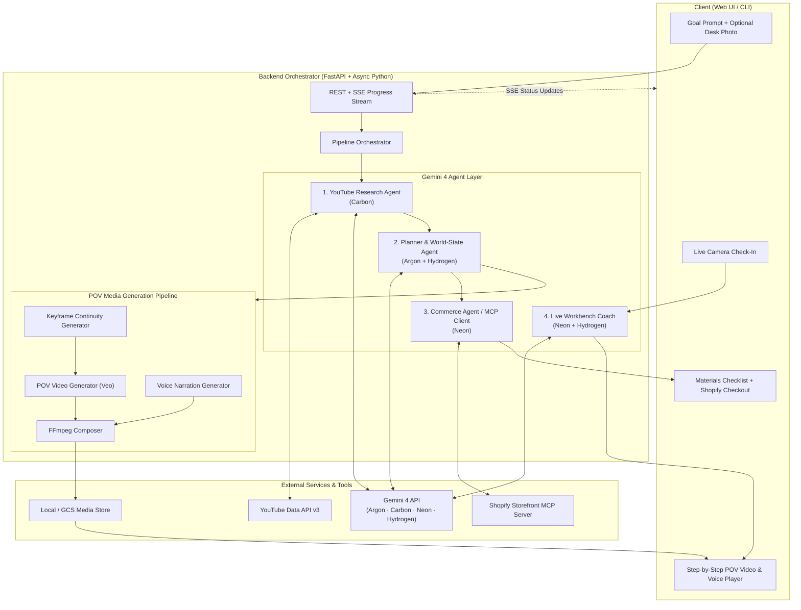
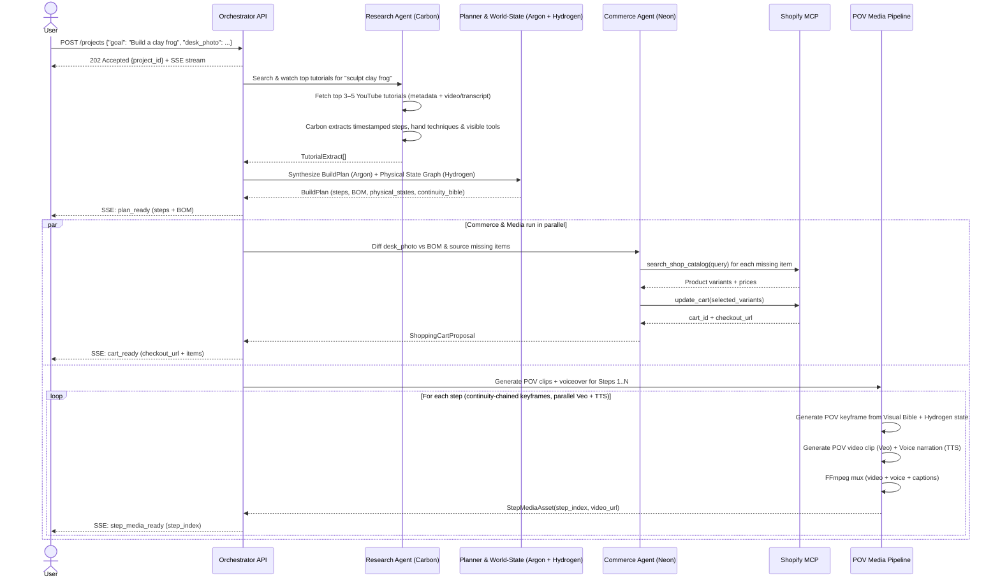

# CraftPOV — System Architecture

This document outlines the technical architecture, **Gemini 4 model routing (`Argon`, `Carbon`, `Neon`, `Hydrogen`) + Decisions API**, agent contracts, physical world-state pipeline, **Shopify (`shop.dev`) MCP** integration, and **Element 119** stress-testing plan for **CraftPOV**.

---

## 1. Gemini 4 Model & Decisions API Routing Strategy

Rather than using one monolithic model for everything, CraftPOV decomposes physical-world assistance across the **Gemini 4** lineup and **Decisions API** so raw video, audio, and images drive every stage:

| Model / API | Config Key | Assigned Responsibilities |
| :--- | :--- | :--- |
| **Gemini 4 Argon** | `GEMINI_MODEL_ARGON` | **Deep Physical Reasoning & Planning**: Reconciles conflicting YouTube tutorials, orders physical dependencies (e.g., armature before bulk clay, drying/curing intervals), and generates failure-mode warnings. |
| **Gemini 4 Carbon** | `GEMINI_MODEL_CARBON` | **Multimodal Video/Audio Comprehension & Visual Coding**: Watches multiple raw YouTube videos (including silent/ASMR or non-English tutorials) to extract timestamped hand techniques, acoustic cues, and implicit tools; generates interactive step overlays. |
| **Gemini 4 Neon** | `GEMINI_MODEL_NEON` | **Low-Latency Agentic Tool Use & Live Interaction**: Executes fast **Shopify (`shop.dev`) Storefront MCP** tool calls, parses messy desk photos to diff owned supplies, and powers real-time voice/camera check-ins. |
| **Gemini 4 Hydrogen** | `GEMINI_MODEL_HYDROGEN` | **Physical World-Model Grounding**: Tracks 3D object state transitions (`start_state` → `hand_kinematics` → `end_state`) and spatial continuity constraints across POV video generation steps and live camera verification. |
| **Decisions API** | `GEMINI_DECISIONS_ENABLED` | **Multimodal Routing & Gating**: Fast, structured decisions over raw media: (1) is a YouTube segment actionable craft footage vs. filler/sponsor, (2) does a user's desk item substitute for a BOM tool, (3) does the user's live webcam frame `PASS` / `ADJUST` / `REDO` the current step. |

---

## 2. High-Level System Architecture



---

## 3. End-to-End Request Lifecycle



---

## 4. Core Components

### 4.1 YouTube Research Agent (`agents/researcher.py` — **Gemini 4 Carbon**)
- **Goal**: Ground physical instructions in real craftspeople's techniques rather than hallucinated text steps.
- **Workflow**:
  1. Queries **YouTube Data API v3** with craft-specific queries (e.g., `"polymer clay frog tutorial for beginners"`), filtering for high-engagement, focused videos (3–15 min).
  2. Passes the top 2–3 YouTube videos to **Gemini 4 Carbon** for native multimodal video understanding.
  3. Extracts timestamped techniques, exact tools/materials visible on screen (even when not mentioned verbally), relative proportions, and hand grips.
- **Output**: `list[TutorialExtract]`

### 4.2 Planner & Physical World-State Agent (`agents/planner.py` — **Gemini 4 Argon + Hydrogen**)
- **Goal**: Merge multiple tutorial extracts into a single, physically valid **BuildPlan** with strict visual and physical continuity.
- **Responsibilities**:
  - **Argon (Deep Reasoning)**: Reconciles differing methods across tutorials, orders physical constraints (e.g., wire armature before sculpting limbs, scoring & slipping clay joints), deduplicates the Bill of Materials (BOM), and writes concise action-first narration scripts (~12–18 words per 6-second clip).
  - **Hydrogen (World-Model Grounding)**: Models the explicit **Physical State Graph** for each step:
    - `start_state` → `hand_kinematics` → `end_state` (e.g., *"walnut-sized sage-green clay sphere → palms rolling in circular motion with light downward pressure → smooth slightly flattened oval torso"*).
    - Generates the **Visual Continuity Bible** (fixed camera tilt, workbench surface, lighting direction, hand appearance, color palette) injected into every POV prompt.

### 4.3 Commerce Agent & Shopify MCP (`agents/commerce.py` — **Gemini 4 Neon**)
- **Goal**: Turn the missing items in the BOM into a one-click checkout experience.
- **Desk Inventory Diffing**: If the user uploads a photo of their workbench, **Neon** identifies already-owned tools/materials and marks them `owned=True` before shopping.
- **Protocol**: Connects via **Model Context Protocol (MCP)** over Streamable HTTP to a Shopify Storefront MCP endpoint (`https://<store>.myshopify.com/api/mcp`).
- **MCP Tool Flow**:
  1. `search_shop_catalog`: Searches for each missing BOM item (e.g., `"air dry clay"`, `"wooden clay sculpting tool kit"`, `"acrylic paint set"`).
  2. **Variant Selection**: Neon picks the best-fitting affordable SKU/variant and records a brief rationale.
  3. `update_cart`: Adds selected variant IDs to a Shopify cart.
  4. `get_cart`: Retrieves subtotal, line items, and the hosted `checkout_url`.
- **Fallback**: Unstocked niche items are surfaced in `unmatched_materials` with a clean search query instead of failing the cart.

### 4.4 POV Media Generation Pipeline (`media/`)
Generating coherent multi-step physical tutorials requires solving visual drift across clips. We use a **3-stage continuity pipeline**:

1. **Keyframe Continuity (`media/video_gen.py`)**:
   - Generates a high-res first-person POV starting keyframe for Step 1 using the `VisualContinuityBible` + `start_state`.
   - For Step `i > 1`, conditions the keyframe on Step `i-1`'s `end_state` (and optionally the extracted final frame from Step `i-1` via FFmpeg) so the workbench, lighting, and clay geometry stay locked.
2. **POV Video Synthesis (`media/video_gen.py`)**:
   - Calls **Veo** (image-to-video) seeded with Step `i`'s keyframe + Hydrogen's hand-kinematics motion prompt.
3. **Voiceover & Muxing (`media/voice_gen.py`, `media/composer.py`)**:
   - Generates calm, clear step narration via TTS (or Veo native audio).
   - **FFmpeg** muxes POV video + voice track + WebVTT/burned-in captions into **individual loopable step MP4s** and a **full stitched MP4**.

### 4.5 Live Workbench Coach (`agents/coach.py` — **Gemini 4 Neon + Hydrogen**)
- **Goal**: Close the loop between digital tutorial and physical reality.
- **Workflow**: At any step, the user clicks **"Check My Progress"** and snaps/streams a webcam frame of their real clay figure.
- **Verification**: **Hydrogen** compares the user's actual physical geometry against the step's expected `end_state`, while **Neon** responds in low-latency voice + text with targeted adjustments (e.g., *"Your legs look great, but press the clay joints firmer so they don't crack when drying"*).

---

## 5. Core Data Schemas (`models.py`)

```python
from pydantic import BaseModel, Field

class MaterialItem(BaseModel):
    name: str
    category: str  # "material" | "tool"
    quantity: str  # e.g. "100g", "1 set"
    required: bool = True
    search_query: str  # Optimized query for Shopify MCP
    owned: bool = False

class VisualContinuityBible(BaseModel):
    workspace_surface: str  # e.g. "matte beige self-healing cutting mat on warm oak desk"
    lighting: str           # e.g. "soft natural window light from left"
    camera_style: str       # e.g. "first-person POV, 45-degree downward angle, stable"
    subject_palette: str    # e.g. "sage green clay, white accents, black glossy eyes"

class PhysicalStateTransition(BaseModel):
    start_state: str        # Physical geometry/state at t=0
    hand_kinematics: str    # Exact hand grip, motion path, and pressure
    end_state: str          # Expected physical geometry/state at t=end
    verification_cues: list[str] = Field(default_factory=list)  # For Live Coach check-in

class BuildStep(BaseModel):
    step_number: int
    title: str
    instruction_text: str
    narration_script: str          # ~12-18 words for voiceover
    pov_video_prompt: str          # First-person POV motion prompt
    physical_state: PhysicalStateTransition
    tips: list[str] = Field(default_factory=list)
    duration_seconds: int = 6

class BuildPlan(BaseModel):
    project_title: str
    difficulty: str                # "beginner" | "intermediate" | "advanced"
    estimated_time_minutes: int
    source_youtube_urls: list[str]
    continuity_bible: VisualContinuityBible
    materials: list[MaterialItem]
    steps: list[BuildStep]

class CartLineItem(BaseModel):
    material_name: str
    product_title: str
    variant_id: str
    price: str
    rationale: str | None = None
    product_url: str | None = None
    image_url: str | None = None

class ShoppingCartProposal(BaseModel):
    cart_id: str | None = None
    checkout_url: str | None = None
    matched_items: list[CartLineItem] = Field(default_factory=list)
    unmatched_materials: list[str] = Field(default_factory=list)
```

---

## 6. API Design (`api.py`)

| Endpoint | Method | Description |
| :--- | :--- | :--- |
| `/api/projects` | `POST` | Submit a build goal + optional owned items / desk photo. Returns `project_id`. |
| `/api/projects/{id}/events` | `GET` | **SSE stream** emitting: `research_started`, `plan_ready`, `cart_ready`, `step_media_ready`, `completed`, `error`. |
| `/api/projects/{id}` | `GET` | Full hydrated project state (`BuildPlan`, `ShoppingCartProposal`, step media URLs). |
| `/api/projects/{id}/cart/rebuild` | `POST` | Recalculate Shopify cart when user toggles owned/needed items in the checklist. |
| `/api/projects/{id}/steps/{step}/checkin` | `POST` | Upload a webcam frame of the user's real progress; returns **Hydrogen + Neon** visual critique & voice audio. |
| `/media/{project_id}/{file}` | `GET` | Serves generated step MP4s, keyframes, voice clips, and stitched video. |

---

## 7. Element 119 Stress-Testing & Breaking-Point Log

To directly answer the **Element 119** judging criteria without synthetic/scripted evals, we benchmark CraftPOV on progressively harder *real-world* inputs and record where the pipeline breaks and how we fix it:

| Stress Test | Hard Real-World Input | What Raw Media Captures (vs. Text) | Where It Broke / Expected Failure Mode | Engineering Fix |
| :--- | :--- | :--- | :--- | :--- |
| **1. Silent / Non-English Craft Video** | 15-min Japanese or ASMR polymer clay video with zero English transcript | Exact hand grips, blade angles, tool swaps, clay thickness | *(Log during hackathon)* e.g. missing material names when packaging isn't zoomed in | Cross-reference 2+ videos; use **Decisions API** to gate low-confidence BOM items |
| **2. Long Messy Footage** | 45-min unedited sculpting livestream with background music & chatter | Real-time mistakes, fixes, and drying pauses edited out of short videos | *(Log during hackathon)* e.g. context dilution / sponsor & chat segments polluting steps | Use **Decisions API** to segment & discard non-craft footage before **Argon** synthesis |
| **3. Cluttered Desk Photo** | Poorly lit photo of a messy desk with substitute tools (butter knife vs. clay rib) | Visual geometry & material equivalence of household substitutes | *(Log during hackathon)* e.g. over-buying tools the user already has a substitute for | **Decisions API** substitution gate (`OWNED_EXACT` / `OWNED_SUBSTITUTE` / `BUY`) before Shopify MCP |
| **4. Multi-Step POV Drift** | 8+ sequential sculpting steps with fine details (eyes, limbs, paint) | Consistent clay shade, lighting, hand pose, and progressive geometry | *(Log during hackathon)* e.g. clay color/scale drifting by Step 5 | Chain last-frame extraction (FFmpeg) + **Hydrogen** `PhysicalStateTransition` + `VisualContinuityBible` |
| **5. Real-Time Camera Coach** | Live webcam stream of user holding half-finished clay piece under warm indoor light | 3D proportion errors, unblended seams, cracking joints | *(Log during hackathon)* e.g. latency spikes or false `PASS` on blurry frames | **Decisions API** frame-quality & pass/adjust gate + low-latency **Neon** voice response |

---

## 8. Key Design Decisions & Hackathon Trade-offs

| Challenge | Architectural Choice | Why |
| :--- | :--- | :--- |
| **Video generation latency** | Stream `plan_ready` and `cart_ready` immediately via SSE; generate step clips in parallel and unlock each step as its MP4 lands. | Judges & users see the plan and live Shopify cart within seconds instead of waiting on all video renders. |
| **Visual & physical drift between steps** | **Hydrogen** `PhysicalStateTransition` + shared `VisualContinuityBible` + keyframe conditioning. | Keeps workbench, lighting, hand pose, and clay geometry physically coherent across independent Veo calls. |
| **Hands-on usability** | Default to **loopable per-step POV clips** + hands-free voiceover. | With clay on your hands, looping a 6-second POV clip of Step 3 beats scrubbing a 20-minute video. |
| **Shopify (`shop.dev`) store coverage** | Storefront MCP with graceful `unmatched_materials` fallback + visual desk-substitution gating. | Keeps the live commerce demo resilient even if a store doesn't stock every niche sculpting tool. |
| **"Wasn't possible last week" factor** | Combine raw multi-video/audio understanding (`Carbon`), deep physical planning (`Argon`), world-state grounding (`Hydrogen`), live camera critique + Shopify MCP (`Neon`), and **Decisions API** gating. | Demonstrates the full Gemini 4 model family working together on an unscripted physical-world loop. |
