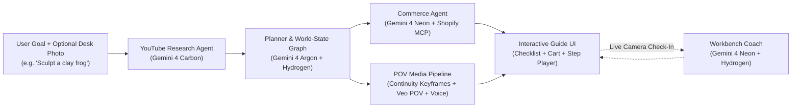

# CraftPOV 🛠️🎥

> **Learn to make anything with your hands — powered by Gemini 4 (Argon, Carbon, Neon & Hydrogen), the Decisions API, POV media generation, and Shopify (`shop.dev`) MCP.**
>
> *Built for the Google DeepMind NYC Gemini 4 Hackathon:*
> - **Track:** Problem Statement Two — **Element 119** *(Multimodal In → Multimodal Out)*
> - **Bonus Track:** **Build with Commerce (Shopify / `shop.dev`)**

CraftPOV turns any live physical-world goal (e.g., *"sculpt a clay frog"*, *"solder a custom macro pad"*, *"make a leather cardholder"*) into a physically grounded, first-person (**POV**) video + voice guide synthesized directly from raw YouTube video/audio streams — and uses a **Shopify (`shop.dev`)** shopping agent to source any tools or materials missing from your desk.

---

## 🎯 Alignment with Hackathon Tracks

### Problem Statement Two: Element 119
CraftPOV **only works** because Gemini 4 can see, hear, decide, and generate media natively — on **unscripted, live inputs** (arbitrary YouTube footage, messy desk photos, and live webcam progress checks):

- **What raw video, audio, and images give us that text loses:**
  - **Silent / non-English / ASMR craft videos**: Many of the best sculpting and craft tutorials have *no spoken narration or transcript at all*. Raw video reveals exact thumb pressure, clay thickness, tool angles, and unmentioned tools sitting on the creator's mat.
  - **Acoustic & visual cues**: Raw audio/video captures scoring sounds, drying consistency, and hand-kinematic timing that text summaries completely flatten.
  - **Live physical verification**: Comparing a real webcam photo of your clay piece against the target step geometry catches proportion or structural issues a text chatbot could never see.
- **Decisions API Integration**: Uses the Gemini **Decisions API** for crisp, deterministic multimodal control flow — filtering out fluff/intro footage, deciding whether a desk item substitutes for a required tool, and gating step progression during live camera check-ins (`PASS` / `ADJUST` / `REDO`).
- **Hardest Inputs & Stress-Testing (Where It Breaks)**: We intentionally stress-test on long (30–60 min) multi-angle tutorials, noisy/non-English audio, cluttered workbenches, and simultaneous multi-stream processing — documenting failure modes and fixes in [ARCHITECTURE.md](./ARCHITECTURE.md#7-element-119-stress-testing--breaking-point-log).

### Bonus Track: Build with Commerce (`shop.dev` / Shopify)
- **Desk-to-Cart Shopping Agent**: Snap a photo of your real workbench → Gemini 4 visually inventories what you already have → diffs against the video-extracted Bill of Materials (BOM) → uses **Shopify (`shop.dev`) Storefront MCP** (`search_shop_catalog`, `update_cart`, `get_cart`) to discover matching supplies, justify variant picks, and build a live hosted checkout cart.

---

## 🧠 Gemini 4 Model & API Routing (Argon · Carbon · Neon · Hydrogen + Decisions API)

CraftPOV routes each stage of the pipeline to the Gemini 4 model best suited for the workload (all model IDs are configurable via `.env`):

| Model / API | Role in CraftPOV | Why It's Used Here |
| :--- | :--- | :--- |
| **Gemini 4 Argon** | **Deep Planner & Physical Reasoner** | Synthesizes conflicting multi-video observations into one physically valid `BuildPlan` (armature, curing, joint scoring) and anticipates failure modes. |
| **Gemini 4 Carbon** | **Multimodal Video/Audio Analyst & Visual Coder** | Ingests raw, long-form YouTube video + audio (including silent/non-English tutorials) to extract hand techniques and implicit tools; generates interactive visual step aids. |
| **Gemini 4 Neon** | **Real-Time Agentic Orchestrator & Shopping Agent** | Powers low-latency **Shopify (`shop.dev`) MCP** product discovery & cart building, desk-photo inventory diffing, and fast live voice/camera coaching. |
| **Gemini 4 Hydrogen** | **Physical World-Model Grounding** | Models 3D object state transitions (`start_state` → `hand_kinematics` → `end_state`) to keep generated POV steps physically coherent and verify live webcam progress. |
| **Decisions API** | **Multimodal Gating & Control Flow** | Makes fast structured routing decisions on raw media: tutorial segment relevance, tool-substitution checks from desk photos, and live step pass/retry verdicts. |

---

## 🔄 How It Works



1. **Goal & Desk Intake**: Enter what you want to build (plus an optional photo/list of supplies you already own).
2. **Research & Synthesis (`Carbon` + `Argon`)**: Pulls top YouTube tutorials, watches them natively, merges best techniques, and extracts a complete BOM + common pitfalls.
3. **Physical State Grounding (`Hydrogen`)**: Builds a continuity-locked progression of object states and hand motions from Step `1` to Step `N`.
4. **Supply Sourcing (`Neon` + Shopify MCP)**: Diffs your desk against the BOM, searches connected Shopify storefronts via MCP (`search_shop_catalog` → `update_cart`), and returns a one-click checkout link.
5. **POV Video + Voice Generation**: Generates first-person over-the-hands video clips with synced voice narration for each step, streamed to the UI as they complete.
6. **Follow Along & Check In**: Loop any POV step hands-free, and hold your physical piece up to the camera for real-time feedback.

---

## 🧱 Tech Stack

| Layer | Technology |
| :--- | :--- |
| **Language & Packaging** | Python 3.14+ (`uv`) |
| **Gemini 4 Models** | **Argon**, **Carbon**, **Neon**, **Hydrogen** (configured via `config.py` / `.env`) |
| **POV Video Generation** | Veo (first-person image-to-video) + keyframe continuity conditioning |
| **Voice Narration** | Gemini Native Audio / TTS |
| **Commerce Integration** | Shopify Storefront MCP (`search_shop_catalog`, `update_cart`, `get_cart`) |
| **YouTube Discovery** | YouTube Data API v3 |
| **Media Processing** | FFmpeg (audio/video muxing, captions, frame extraction, stitching) |
| **API & UI** | FastAPI (SSE progress streaming) + interactive Web UI |

---

## 📁 Planned Project Structure

```text
nyc-gemini4-hack/
├── README.md
├── ARCHITECTURE.md            # Deep-dive system design, model routing, schemas & flows
├── pyproject.toml
└── src/
    └── nyc_gemini4_hack/
        ├── __init__.py
        ├── config.py          # Env vars & Gemini 4 model routing (Argon/Carbon/Neon/Hydrogen)
        ├── models.py          # Pydantic schemas (BuildPlan, PhysicalState, BOM, POVClipSpec)
        ├── agents/
        │   ├── researcher.py  # YouTube search + Gemini 4 Carbon video analysis
        │   ├── planner.py     # Argon reasoning + Hydrogen physical state graph
        │   ├── commerce.py    # Neon agent + Shopify Storefront MCP client
        │   └── coach.py       # Live camera/voice workbench check-in
        ├── media/
        │   ├── video_gen.py   # Continuity-chained keyframes + Veo POV video gen
        │   ├── voice_gen.py   # Step narration synthesis (TTS)
        │   └── composer.py    # FFmpeg muxing, frame chaining & step assembly
        ├── pipeline.py        # End-to-end async orchestrator
        └── api.py             # FastAPI server + SSE job updates
```

---

## 🚀 Getting Started

### Prerequisites
- Python `>=3.14` and [`uv`](https://docs.astral.sh/uv/)
- `ffmpeg` installed on your system (`brew install ffmpeg`)
- API keys & endpoints:
  - `GEMINI_API_KEY` (with access to Gemini 4 Argon, Carbon, Neon, Hydrogen + Veo)
  - `YOUTUBE_API_KEY` (YouTube Data API v3)
  - `SHOPIFY_MCP_URL` (e.g., `https://<your-store>.myshopify.com/api/mcp`)

### Setup

```bash
# Install dependencies
uv sync

# Configure environment & Gemini 4 model IDs
cp .env.example .env
# Fill in GEMINI_API_KEY, GEMINI_MODEL_ARGON, GEMINI_MODEL_CARBON,
# GEMINI_MODEL_NEON, GEMINI_MODEL_HYDROGEN, YOUTUBE_API_KEY, SHOPIFY_MCP_URL

# Run the CLI / server (once implemented)
uv run nyc-gemini4-hack
```

---

## 🗺️ Hackathon Build Plan

- [x] Project scaffolding & architecture design
- [ ] **Milestone 1 — Research & Physical Plan (`Carbon` + `Argon` + `Hydrogen`)**: YouTube search + multimodal video analysis → structured `BuildPlan`, Physical State Graph & BOM
- [ ] **Milestone 2 — Shopify MCP Commerce (`Neon`)**: Desk-photo/list diffing + live Shopify MCP catalog search & checkout URL generation
- [ ] **Milestone 3 — POV Media Pipeline**: Continuity-chained keyframes + Veo POV clips + voiceover muxing
- [ ] **Milestone 4 — Interactive Demo UI**: Step-by-step loopable POV player with material checklist, checkout button & SSE progress stream
- [ ] **Milestone 5 (Wow Factor) — Live Workbench Coach**: Hold your clay figure up to the webcam for real-time visual critique & voice guidance

---

## 📖 Architecture

See [ARCHITECTURE.md](./ARCHITECTURE.md) for the full technical design, Gemini 4 model routing, Shopify MCP integration details, physical continuity strategy, and Pydantic data schemas.
