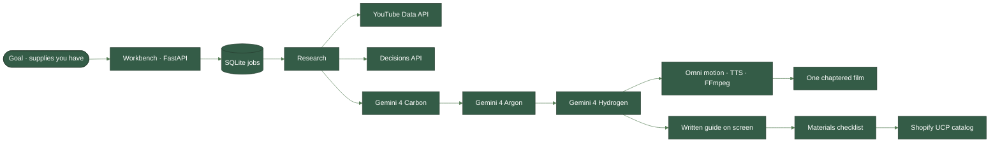
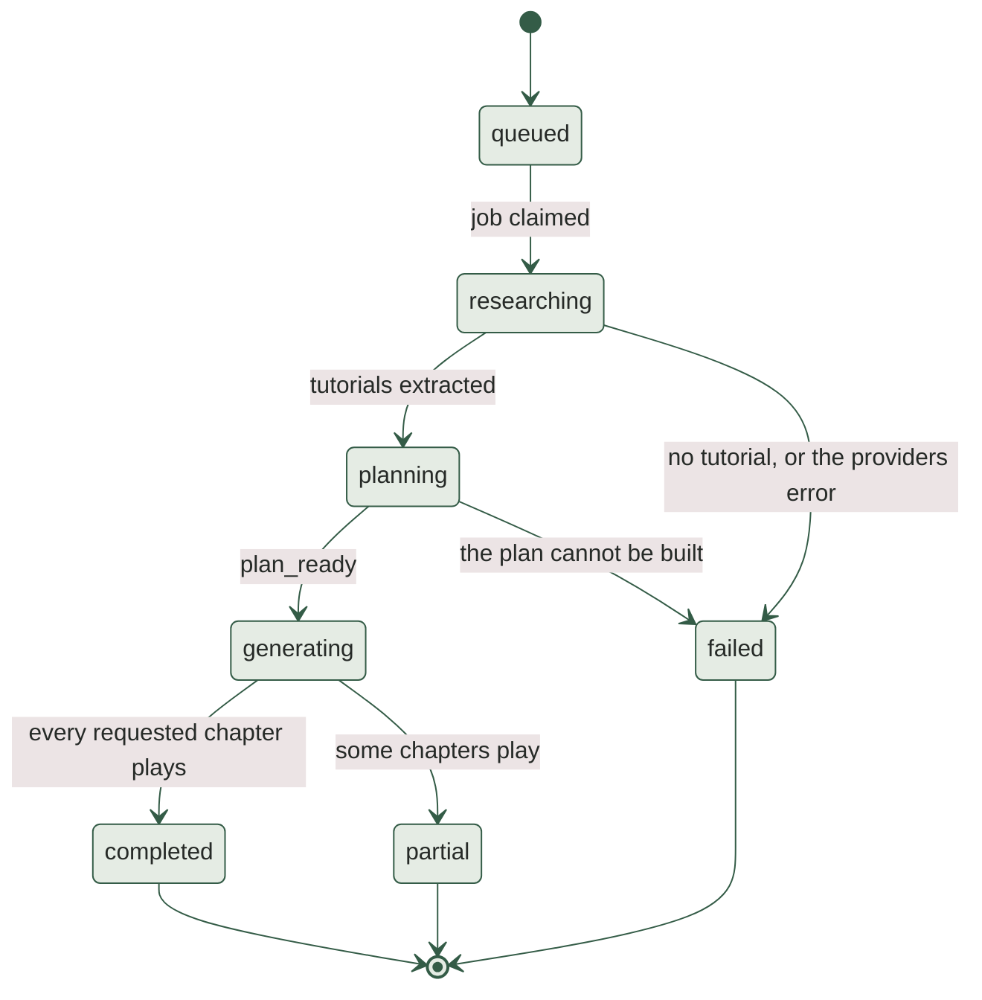

# CraftPOV

**Hands stay on the paper. The film keeps the fold.**

CraftPOV is a maker’s workbench. Name a physical project and the supplies already on the desk. It watches real YouTube tutorials, writes the steps and the materials list as soon as the plan is ready, then plays the whole build as one narrated film. Choose a chapter to replay a fold. The written instruction follows playback. The checklist stays in the browser tab.

Google DeepMind NYC Gemini 4 Hackathon

[](./PRD.md)
[](./ucp-agent-profile.json)
[](https://www.python.org)
[](https://fastapi.tiangolo.com)
[](https://react.dev)
[](https://ai.google.dev)
[](https://vercel.com)
[](https://ucp.dev)

---

## The tutorial is the bottleneck

Learning a fold, a joint, or a clay body from YouTube means scrubbing a twenty-minute timeline with busy hands. The useful seconds are buried in intros, and a lot of the best craft footage has no narration to scrub through: silent builds, ASMR, music, or a language you do not speak. A transcript drops the things the camera actually has — thumb pressure, how thick the paper stack is, the tool sitting on the mat that nobody named.

Two jobs share one page. Someone gathering supplies needs a quantity. Someone mid-fold needs to replay the same chapter until the edges meet. CraftPOV puts the written guide on screen before the film exists, then keeps that chapter, its narration, and a check the maker can see with the sound off.

---

## Open the workbench

The homepage opens **Fold a paper plane**, a seven-chapter guide to a classic dart. Its 52-second captioned film combines generated hand footage with labeled diagrams of each difficult fold. Each chapter links to the corresponding moment in the original demonstration.

| Surface | Where |
| --- | --- |
| Workbench | [http://localhost:8000](http://localhost:8000) after the commands below |
| Example guide | `/` · `src/nyc_gemini4_hack/web/example/` |
| A generated guide | `/?project={project_id}` |
| Readiness | [`GET /api/health`](./DEPLOYMENT.md) · `generation_ready` |
| Shopify agent profile | [`/ucp-agent-profile.json`](./ucp-agent-profile.json) |

Creating a guide asks for the project (up to 300 characters) and an optional comma-separated list of supplies. The plan’s title, difficulty, time, and step count appear as soon as planning finishes. Chapters in the sidebar seek the shared film. Each step shows the action, a **Check your work** cue, technique notes, and the narration transcript. Materials split into **Still needed**, **Gathered**, and **Optional**.

---

## What it does

- Searches YouTube, then keeps the videos that are actually hands-on. The gate is the Gemini Decisions API (`KEEP_TUTORIAL` / `SKIP_FILLER`), with a structured-model fallback when that call fails.
- Watches the chosen videos with **Gemini 4 Carbon**, including silent, music-only, and non-English footage. The extract keeps timestamped hand actions, tools visible on the bench, and mistakes the footage shows.
- Writes one beginner plan with **Gemini 4 Argon**: ordered steps, a deduplicated materials list, and a short narration script that starts with the verb.
- Locks the physical film with **Gemini 4 Hydrogen**: one work surface, light, camera, and pair of hands, plus each step’s start, contact, and finished state.
- Publishes that written guide immediately. Rendering continues in the background. A later step can be read while the first clip is still generating.
- Films each chapter with **Gemini Omni** (`gemini-omni-1.2-flash` by default). A continuing action opens on the previous shot’s final frame. Independent pieces can render together.
- Speaks the script with Gemini TTS, then muxes narration, captions, and a single chaptered MP4 with FFmpeg. Playback follows the plan’s order. The written step advances when the film crosses a chapter boundary.
- Matches supplies the maker typed to the materials list, and lets them check items off in the tab.
- Looks up required and optional supplies in the Shopify UCP catalog. Open a gathered item to see replacements. Each result links to the merchant’s product or checkout and shows the price when available. Empty or unavailable results can be retried.

Set `POV_MEDIA_MODE=illustrated_frames` to render still keyframes instead of Omni motion. On a machine without cloud speech, macOS `say` or eSpeak can read the same script.

---

## How a guide is made

One rule runs the pipeline: **the models watch, plan, and film; the orchestrator decides what is published.** A chapter that fails stays a chapter error. The written guide and the checklist remain.



| Part | What it does | Status |
| --- | --- | --- |
| Intake | Goal and owned supplies. The API also accepts a JPEG, PNG, or WebP desk photo and stores the file. | Built |
| Research | Search a few YouTube candidates, gate them, and watch one usable tutorial by default. A spare is kept when the first watch fails. Direct `--url` values skip the gate. | Built |
| Plan | Argon writes the `BuildPlan`. Owned names that match a material become `OWNED_EXACT`. Hydrogen rewrites continuity, prompts, and physical states. | Built |
| Film | Omni shots, Gemini speech, per-chapter MP4s, WebVTT, then one stitched film. Illustrated mode is the other `POV_MEDIA_MODE`. | Built |
| Workbench | Sidebar chapters, shared player, synchronized reading, source links, checklist in the tab. | Built |
| Catalog | `GET /api/shopping/search` calls Shopify UCP `search_catalog` and returns up to three offers. | Built |
| Cart agent | Finds Shopify offers for missing materials while chapters render. Rebuilding the cart updates the owned items and returns a merchant checkout link when the configured store has matching variants. | Built |
| Desk inventory | The photo is stored with the project. Nothing in the planner looks at it. | Planned |
| Live coach | Starts a Gemini Live session with the current guide and can inspect a camera frame against a chapter’s expected result. | Built |

The public profile at `/ucp-agent-profile.json` advertises the UCP shopping capabilities at spec `2026-08-25`. The global catalog supplies offers across merchants. Checkout uses variants from the configured store and opens on that store.

---

## Why the video has to be the input

Element 119 asks for multimodal in and multimodal out, on inputs nobody scripted. The research prompt tells Carbon to trust the picture when the words are missing.

| What a transcript keeps | What CraftPOV keeps from the footage |
| --- | --- |
| Spoken steps, when any exist | Grips, contact, proportions, and tool swaps, including videos with no speech |
| A title and a description | A decision, per candidate, on whether the video is a tutorial or filler |
| One creator’s order | One plan merged from the videos that survived the gate, with drying and assembly order made explicit |
| A paragraph to read | A first-person chapter, a spoken line, captions, and a visible check (“two tips meet”) |

Model IDs are environment variables, so a hackathon key can point Argon, Carbon, Neon, Hydrogen, Decisions, Omni, and TTS at whatever slugs the account can call. The tutorial gate calls the Decisions API first. When that call fails, the same questions go to Gemini 4 Neon as structured choices. Catalog search is ordinary HTTP to the UCP endpoint, with the global Shopify catalog when no store URL is set.

---

## A project, from click to film



`plan_ready` is the moment the workbench becomes useful. Media events arrive per chapter, including out of order when two pieces render at once. The full film and its caption file are published only after assembly, in plan order. Refreshing the page reloads the snapshot. The hosted event stream reconnects and continues from the stored revision.

Locally, one process serves the API and renders. On Vercel, the Python function accepts the project and streams progress. A daemon in `iad1` claims the job, renders, and uploads media to Blob. Turso holds the shared SQLite tables. [Deployment](./DEPLOYMENT.md)

---

## Run it

Python 3.14 and the lockfile. FFmpeg ships inside `imageio-ffmpeg`.

```bash
uv sync --locked
npm --prefix frontend ci
npm --prefix frontend run build
cp .env.example .env
# GEMINI_API_KEY, YOUTUBE_API_KEY, and the model ids your account can call.
uv run nyc-gemini4-hack
```

Open [http://localhost:8000](http://localhost:8000). Jobs land in SQLite at `SQLITE_PATH` (default `./data/craftpov.sqlite3`). Rendered files land under `MEDIA_OUTPUT_DIR` (default `./outputs`).

The CLI writes `outputs/{project_id}/project_state.json` and can render a saved plan later.

```bash
uv run python -m nyc_gemini4_hack.cli "Fold a paper plane" --owned "paper" --skip-media
uv run python -m nyc_gemini4_hack.cli --from-json outputs/PROJECT_ID/project_state.json
uv run python -m nyc_gemini4_hack.cli "Sculpt a small clay bowl" --url "https://www.youtube.com/watch?v=VIDEO_ID" --max-videos 1
```

`--max-media-steps` caps how many chapters are filmed. `--skip-media` stops after the written plan.

```bash
uv run python -m unittest discover -s tests
cd frontend && npm ci && npx playwright install chromium && npm test
```

The Python tests use stand-in provider responses and assemble real MP4s. `uv run python tests/benchmark_media.py` replays the example media through the scheduler. Frontend tests build the workbench and drive it in Chromium.

### Secrets

Copy [`.env.example`](.env.example).

| Concern | Variables |
| --- | --- |
| Models | `GEMINI_API_KEY`, `GEMINI_MODEL_ARGON`, `GEMINI_MODEL_CARBON`, `GEMINI_MODEL_NEON`, `GEMINI_MODEL_HYDROGEN` |
| Gating | `GEMINI_DECISIONS_ENABLED`, `GEMINI_DECISIONS_MODEL`, `GEMINI_DECISIONS_API_VERSION` |
| Film | `POV_MEDIA_MODE`, `POV_VIDEO_MODEL`, `POV_IMAGE_MODEL`, `AUDIO_MODEL`, `TTS_VOICE` |
| Live coach | `LIVE_COACH_MODEL`, `LIVE_COACH_API_VERSION` |
| Discovery | `YOUTUBE_API_KEY` |
| Catalog | `SHOPIFY_GLOBAL_MCP_URL` selects the global catalog. `SHOPIFY_MCP_URL` enables store checkout. `SHOPIFY_SHOP_DOMAIN` can select a store for checklist searches. The store client accepts `SHOPIFY_STOREFRONT_TOKEN`. `SHOPIFY_AGENT_PROFILE_URL` takes precedence over `SHOPIFY_UCP_AGENT_PROFILE_URL`. |
| Local files | `APP_HOST`, `APP_PORT`, `MEDIA_OUTPUT_DIR`, `SQLITE_PATH` |
| Hosted | `TURSO_DATABASE_URL`, `TURSO_AUTH_TOKEN`, `BLOB_READ_WRITE_TOKEN` |

Hosted intake accepts a desk photo up to 4 MiB. Local intake accepts 8 MiB.

---

## Project layout

```
app.py                         Vercel FastAPI entry, hosted=True
src/nyc_gemini4_hack/
  server.py                    Projects, live updates, media, shopping and coaching routes
  pipeline.py                  Research → plan → film
  agents/researcher.py         YouTube search, Decisions gate, Carbon watch
  agents/planner.py            Argon plan, Hydrogen grounding
  agents/commerce.py           Global options, store variants and checkout
  agents/coach.py              Live sessions and visual checks
  media/motion_gen.py          Omni shots and continuity frames
  media/video_gen.py           Illustrated keyframes
  media/voice_gen.py           Gemini TTS, then say / eSpeak
  media/composer.py            Chapter MP4s, WebVTT, full film
  shopping.py                  UCP catalog search
  job_store.py                 Local SQLite and Turso
  cloud_worker.py              Prepares guides ahead while rendering one film at a time
  web/example/                 Paper-plane film, captions, and project.json
frontend/src/                  React workbench (Vite 8)
ucp-agent-profile.json         Shopify UCP agent profile
```

---

## Stack

| Layer | Choice |
| --- | --- |
| Language | Python 3.14, `uv`, Pydantic |
| API | FastAPI, SSE progress, an embedded async worker locally or a Vercel daemon |
| UI | React 19, Vite 8, one native `<video>` for the whole film |
| Research | YouTube Data API v3, Gemini Decisions API, Gemini 4 Carbon |
| Plan | Gemini 4 Argon, Gemini 4 Hydrogen |
| Picture and voice | Gemini Omni, Gemini TTS, FFmpeg via `imageio-ffmpeg` |
| Commerce | Shopify UCP Catalog MCP (`search_catalog`) |
| State | SQLite locally, Turso when hosted |
| Media delivery | Files under `outputs/`, or Vercel Blob with redirects |

---

## Documents

| Doc | What it covers |
| --- | --- |
| [`PRD.md`](./PRD.md) | Hackathon problem, persona, and the original requirements |
| [`ARCHITECTURE.md`](./ARCHITECTURE.md) | Model routing, request lifecycle, shopping, coaching and schemas. |
| [`DESIGN_NOTES.md`](./DESIGN_NOTES.md) | Why the workbench is a guide and a player on one page |
| [`docs/generation.md`](./docs/generation.md) | Shot continuity, parallel folds, and how long a film spends waiting on Omni |
| [`docs/video-quality.md`](./docs/video-quality.md) | 2026 research, timestamped source footage, and visual checks on rendered actions |
| [`DEPLOYMENT.md`](./DEPLOYMENT.md) | Vercel, Turso, Blob, and the rendering daemon |
| [`docs/STATUS.md`](./docs/STATUS.md) | An earlier checkpoint. The status table in this README matches the current tree. |

---

## Workbench green

The UI is a quiet document: a rail of chapters, a film, a step you can read with the player paused.

| Token | Value | Role |
| --- | --- | --- |
| Page | `#FEFEFD` | The guide |
| `--rail` | `#F7F8F5` | Sidebar |
| `--ink` | `#262A27` | Titles and steps |
| `--muted` | `#5E655E` | Meta, times, transcripts |
| `--border` | `#DFDFD8` | The only hard separator |
| `--accent` | `#345C47` | Links and the current chapter |
| `--accent-soft` | `#E5ECE4` | The selected step |
| Player | `#26382F` | The film well |

The wordmark’s mark is `#263B2E` with a paper-fold glyph in `#F0F3DE`. Focus rings are `#3374A2`. Phone width keeps the current step near the top and the chapter list within reach.

---

A twenty-minute video was never meant to be the only pair of hands in the room.

**CraftPOV watches the tutorial, then stays with the fold.**
